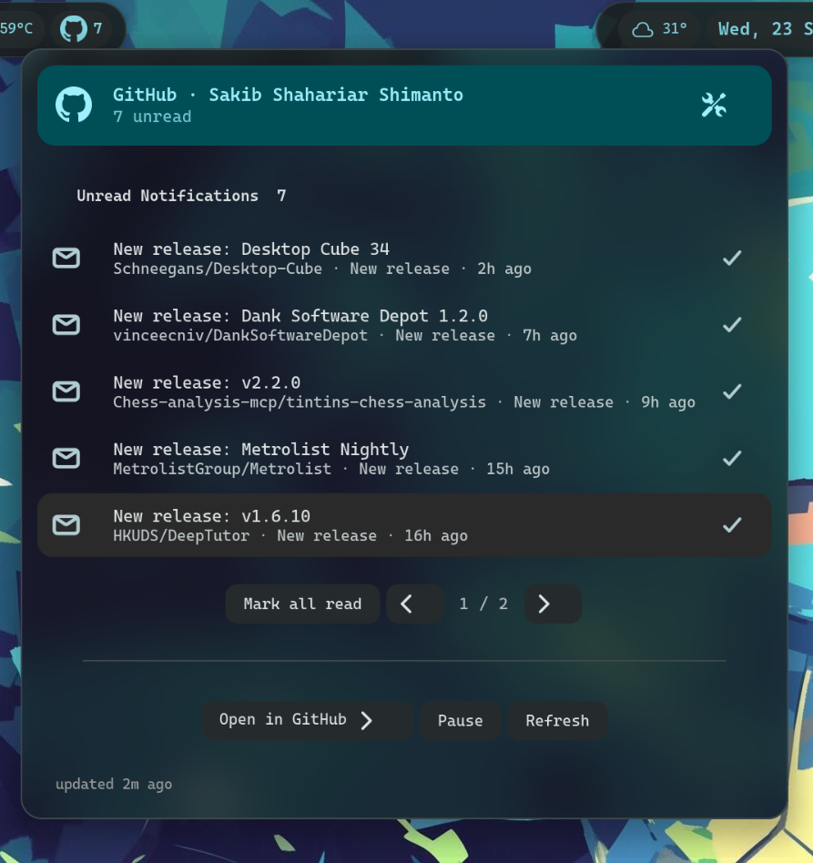

# GitHub Notifier

A GNOME Shell extension for GitHub notifications and repository activity.

- See and manage GitHub notifications from the top bar.
- Watch repositories for new issues, pull requests, and star changes.
- Get desktop alerts with filters and quiet hours.

**Requires GNOME Shell 45–51.** [Install and set up](docs/user-guide.md#install-from-source).

[User guide](docs/user-guide.md) · [Report a bug](https://github.com/SakibShahariar/github-notifier/issues) · [GPL-3.0-or-later](LICENSE)
