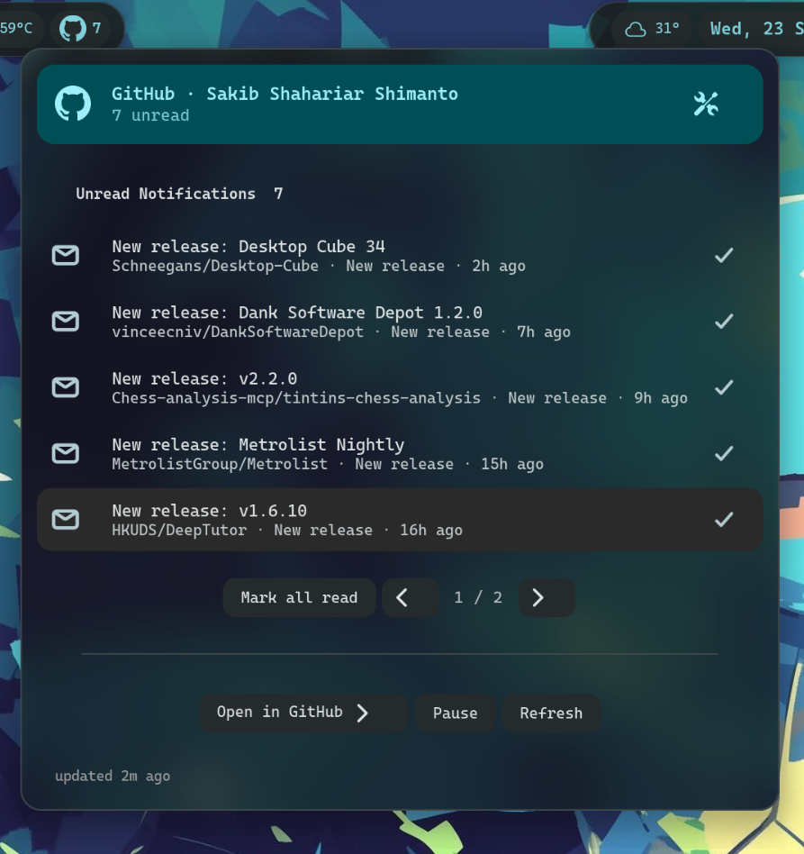

# GitHub Notifier

> Mentions, reviews, issues/PRs, and stars — right in your GNOME top panel.


GitHub Notifier is a GNOME Shell extension that brings your GitHub activity into the top panel. It displays your unread GitHub inbox, watches selected repositories for new issues and pull requests, and tracks star-count changes — without needing to keep GitHub open in a browser.

## Screenshot



## Features

| Feature | Description |
|---|---|
| 💬 **Inbox** | Mirrors your unread GitHub notifications. |
| 📝 **Repository watching** | Checks selected repositories for new issues and pull requests. |
| ⭐ **Star tracking** | Detects changes in repository star counts. |
| 🔔 **Desktop notifications** | Notifications with Open and Mark read actions, grouped by repository. |
| ⏸️ **Pause polling** | Temporarily stop checks from the panel menu. |
| 👁️ **Hide when empty** | Keep the panel icon hidden when there is nothing to show, unless an error needs attention. |

The inbox uses GitHub's notifications API with `participating=false`, so it includes unread activity such as mentions, review requests, and subscribed threads. Star tracking detects count changes; it does not identify individual new stargazers.

**Mark all as read** updates the local view and sends a request to GitHub to mark notifications as read.

## Requirements

- GNOME Shell 45–51. Compatibility depends on the GNOME version and should be verified against the extension's current release.
- A GitHub personal access token with the permissions required for the API features you use.
- An internet connection. The extension pauses polling when the connection is detected as limited or local-only.

## Installation

Clone the repository, then install the extension files into the directory matching its UUID:

```bash
git clone https://github.com/SakibShahariar/github-notifier.git
cd github-notifier

UUID="github-notifier@local"
DEST="$HOME/.local/share/gnome-shell/extensions/$UUID"

mkdir -p "$DEST/schemas" "$DEST/icons"
cp extension.js prefs.js metadata.json stylesheet.css "$DEST/"
cp icons/* "$DEST/icons/"
cp schemas/*.xml "$DEST/schemas/"
glib-compile-schemas "$DEST/schemas/"
```

Then enable the extension:

```bash
gnome-extensions enable github-notifier@local
```

On X11, you can restart GNOME Shell with **Alt+F2**, then enter `r`. On Wayland, log out and log back in if required.

Open the extension preferences from the panel menu or run:

```bash
gnome-extensions prefs github-notifier@local
```

## Configuration

| Setting | Description |
|---|---|
| **Token** | Your GitHub personal access token. Create one from [GitHub Settings](https://github.com/settings/personal-access-tokens). |
| **Username** | Your GitHub username. |
| **API host** | GitHub's API host, or the API endpoint for your GitHub Enterprise Server instance. |
| **Repositories** | Comma-separated repository names in `owner/repo` format. |
| **Poll interval** | How often to check for updates: 30–3600 seconds, with a default of 120 seconds. |

Settings are organized into **Account**, **Watching**, and **Settings** sections.

### Token permissions and security

Use a token with only the permissions needed for your setup. Private repositories may require additional repository access. Actions that modify notification read status need the relevant write permission; a read-only token will not support every action.

The token is currently stored in GNOME's GSettings/dconf configuration and is not encrypted by the extension. Avoid using a token on a shared or compromised machine, and revoke it if it may have been exposed.

## How it works

- Polls GitHub's notifications API for unread notifications.
- Checks selected repositories for issues and pull requests.
- Checks repository star counts for changes.
- Uses a configurable polling interval and limits the number of notifications displayed.
- Shows a tracking-status notification when monitoring starts.

The panel may display an error indicator when GitHub requests fail. Rate limits and permission errors are different conditions and should be diagnosed accordingly.

## GitHub Enterprise Server

Configure the API host for your Enterprise instance. GitHub.com and Enterprise installations may use different API and web URL formats.

If your Enterprise instance is hosted under a URL path rather than directly at the domain root, verify that generated browser links preserve that path. Support for a particular Enterprise deployment layout depends on the current implementation.

## Troubleshooting

- **No notifications:** Check that the token is valid and has the required permissions.
- **Repository watching does not work:** Verify each repository uses the `owner/repo` format and that the token can access it.
- **Rate-limit errors:** Reduce polling frequency or wait for the applicable GitHub rate limit to reset.
- **Connection-related issues:** Check that your network is fully connected.
- **GNOME Shell logs:** Follow the shell log with:

  ```bash
  journalctl -f /usr/bin/gnome-shell
  ```

- **Looking Glass:** On X11, press **Alt+F2** and enter `lg` to open GNOME Shell's debugging tool.

## Uninstall

Disable the extension, remove its directory, and reset its settings:

```bash
gnome-extensions disable github-notifier@local
rm -rf ~/.local/share/gnome-shell/extensions/github-notifier@local
dconf reset -f /org/gnome/shell/extensions/github-notifier/
```

## Feedback

Found a bug or have an idea? Open an [issue](https://github.com/SakibShahariar/github-notifier/issues) or contribute via a pull request.
